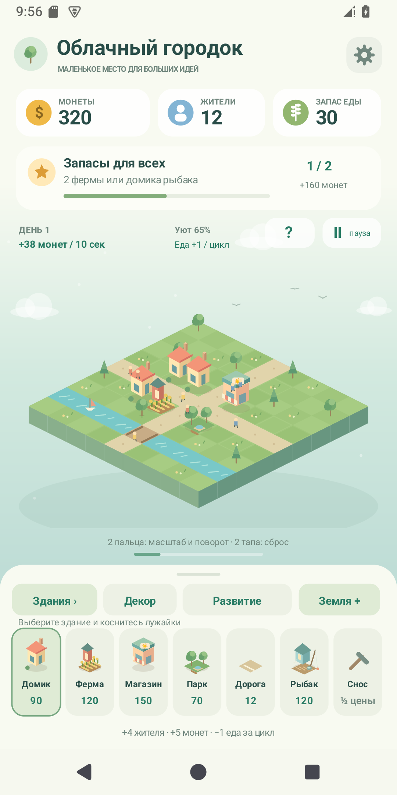
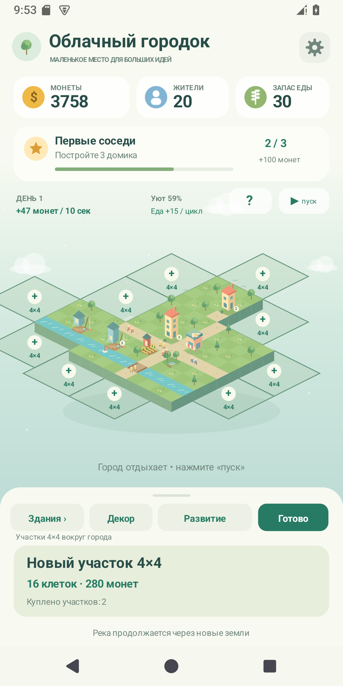
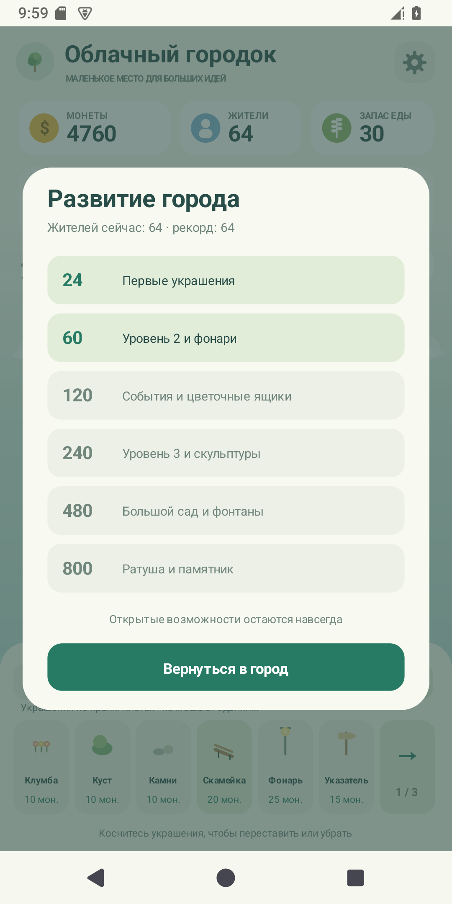
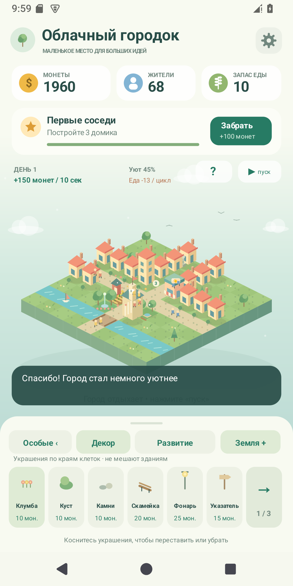

# Облачный городок ☁️

Небольшой мультяшный градостроительный симулятор для Android, чтобы играть в самолёте. Нативное приложение на Java с изометрической графикой Canvas. Вся графика процедурная, без сторонних библиотек.

## Установка на телефон

1. Перенесите **[dist/CloudTown.apk](dist/CloudTown.apk)** на Android-телефон через USB, облако или мессенджер.
2. Откройте APK на телефоне. Если Android попросит, разрешите установку приложений для того файлового менеджера или браузера, через который открываете файл.
3. Нажмите «Установить» и откройте **Облачный городок**. Пройдите короткую подсказку. После установки интернет не нужен, можно включить авиарежим.

Поддерживается Android 6.0 и новее. APK подписан локальным отладочным ключом для личного использования; публикация в Google Play не требуется. Перед полётом стоит открыть игру на своём устройстве и проверить управление.

## Как играть

- Разведите или сведите **два пальца** для изменения масштаба (70–300%). Поворачивайте два пальца вокруг друг друга, чтобы крутить остров.
- **Одним пальцем** перетаскивайте карту. **Двойное касание** в одной точке возвращает исходный вид. Положение камеры сохраняется автоматически; жесты работают и на паузе.
- Нажмите **«Земля +»** над постройками. На карте появятся доступные участки **4×4** по сторонам города. Коснитесь участка с плюсом и подтвердите покупку. Первый стоит **160 монет**, каждый следующий на **60 монет дороже**. Нажмите «Готово», чтобы вернуться к строительству.
- Каждый участок добавляет ровно 16 клеток и открывает соседние участки. Расширяться можно во все четыре стороны в пределах мира 41×41. Река продолжается через новые земли; некоторые из 16 клеток могут быть водой. Здания и дороги строятся только на купленных клетках.
- Выберите постройку внизу и коснитесь свободной клетки. На лужайках со знаком «+» можно поставить выбранный тип здания.
- Домики, фермы и магазины требуют соседнюю дорогу. Дороги расширяют доступную территорию. Парки можно сажать на любой лужайке.
- Домик стоит 90 монет, даёт 4 жителей и 5 монет за цикл, потребляет 1 еду.
- Ферма стоит 120 монет и производит 4 еды за цикл.
- **Домик рыбака** (кнопка «Рыбак») стоит **120 монет** и даёт **4 еды за цикл**, как ферма. Его можно поставить только на свободной клетке суши, соседней с рекой по стороне. Диагональное соседство не подходит. Дорога не требуется. При улучшении до уровней 2 и 3 он даёт 8 и 12 еды соответственно; цены улучшений такие же, как у фермы.
- Магазин стоит 150 монет и даёт 9 монет за цикл.
- Парк стоит 70 монет и повышает настроение на 9 пунктов. Хорошее настроение увеличивает общий доход.
- Дорога стоит 12 монет. У города есть базовый доход, поэтому потраченные монеты всегда можно накопить снова.
- Один экономический цикл — **10 секунд активной игры**. Полоска под островом показывает время до дохода. Нехватка еды снижает настроение; жители не погибают.
- Коснитесь здания, чтобы улучшить его. **Уровень 2 открывается при 60 жителях, уровень 3 — при 240.** Дом вмещает 4/8/12 жителей и потребляет 1/2/3 еды за цикл. Достигнутые пороги учитываются по рекорду населения и сохраняются после сноса домов.
- Выполняйте задания сверху и нажимайте «Забрать» для получения награды. После пятнадцати заданий можно продолжать свободное строительство.
- «Снос» возвращает половину базовой стоимости с учётом уровня. Река и дороги защищены от сноса.
- Кнопка паузы останавливает город. Настройки позволяют отключить звуки, открыть помощь или начать заново с подтверждением.

В городе гуляют жители, по реке плывёт лодка, над островом летают птицы и плывут облака. Вечерняя подсветка меняется в течение четырёхминутного игрового дня. Новые здания сопровождаются конфетти, звуком и тактильным откликом.


## Этапы развития и украшения

Кнопка **«Развитие»** показывает этапы и рекорд населения:

| Жителей | Открытие |
| --- | --- |
| 24 | Клумбы, кусты и камни |
| 60 | Уровень 2; скамейки, фонари, указатели |
| 120 | События; заборчики, цветочные ящики и кашпо |
| 240 | Уровень 3; дорожки, скульптуры и навесы |
| 480 | Большой сад; фонтан, гирлянда и праздничная ель |
| 800 | Ратуша; памятник, арка и флаг |

Цены именно **улучшений**, без стоимости первого строительства:

| Здание | До уровня 2 | До уровня 3 |
| --- | --- | --- |
| Дом | 120 | 180 |
| Ферма / домик рыбака | 160 | 240 |
| Магазин | 200 | 300 |
| Парк | 100 | 140 |

Нажмите **«Декор»**, выберите украшение и коснитесь края клетки. Четыре стороны каждой клетки — независимые места. Декор не занимает место здания и не меняет доход или вместимость. Есть 18 видов по 10–120 монет, страницы переключаются стрелкой. В режиме декора касание существующего украшения открывает бесплатную перестановку или удаление с возвратом половины цены. При отмене переноса украшение остаётся на месте.

Повторное нажатие **«Здания ›»** открывает особые постройки: большой сад за 1000 монет (+12 к уюту) и ратушу за 2000 (+40 монет за цикл). Они требуют дорогу, строятся по одному экземпляру и имеют один уровень.

После 120 жителей появляются события. Кнопка **«!»** рядом с паузой открывает выбор: обмен еды, праздник за 40 монет с бонусом +10 уюта и +4 монеты за цикл на 2 минуты активной игры или помощь садовников. События ждут решения без срока; после завершения следующее появляется через 8 экономических циклов. При закрытой игре и в открытых меню время не идёт.

## Сохранение и офлайн

Прогресс автоматически сохраняется после строительства, улучшения, награды, каждого экономического цикла и при сворачивании. Сохранение хранится в приватных настройках приложения на телефоне. Закрытое приложение и открытые меню приостанавливают симуляцию: возвращаться по расписанию не нужно. Пауза снимается при повторном запуске.

У приложения **нет разрешения на интернет**, рекламы, аккаунтов, платежей, аналитики и загружаемых ресурсов. Звук учитывает системную громкость мультимедиа. Удаление приложения или очистка его данных удалит город. При повреждённом сохранении создаётся новый город.

## Исходники и сборка

Откройте эту папку в Android Studio и дождитесь синхронизации Gradle. Нужны JDK 17, Android SDK Platform 35 и Android Build Tools 35.0.0. Для проекта без Gradle Wrapper используйте установленный Gradle 8.9 или сборку ниже.

Альтернативная сборка без Gradle и сторонних зависимостей:

```sh
export JAVA_HOME="/путь/к/jdk-17"
export ANDROID_HOME="/путь/к/Android/sdk"
python3 tools/build.py
```

Скрипт сначала запускает тесты, затем компилирует Java, создаёт DEX, упаковывает, выравнивает и подписывает APK, проверяет подпись. Результат: `dist/CloudTown.apk`. При наличии локального набора инструментов в `.toolchain` переменные окружения не нужны.

Ключ личной сборки создаётся в `.toolchain/cloudtown-debug.keystore`. Сохраните его, если планируете устанавливать обновления поверх этой версии без удаления города. Не используйте этот отладочный ключ для публикации. Android Studio создаёт APK с собственным ключом: установка поверх приложенного APK потребует совпадающей подписи.

Проверка игровой логики отдельно:

```sh
python3 tools/build.py --test
```

`GameState.java` — независимая от Android симуляция, `GameView.java` — графика и сенсорное управление, `MainActivity.java` — жизненный цикл приложения. `tests/GameStateTest.java` проверяет строительство, дороги, улучшения, экономику, паузу, снос, задания, восстановление сохранений и длительную симуляцию.

Версия **1.3** добавляет этапы развития, доступ к улучшениям по населению, декор, события и особые постройки. APK подписан тем же ключом: установите его поверх версий 1.0–1.2. Здания, земля, ресурсы и камера сохраняются. Достигнутые ранее уровни зданий остаются доступными даже при маленьком населении; старая цепочка заданий продолжается новыми целями. Старые сохранения автоматически переходят в формат 3.

`MapCamera.java` отвечает за проекцию карты и обратное преобразование касаний. `tests/MapCameraTest.java` проверяет координаты при разных углах и масштабах, точку под пальцами, пределы масштаба и восстановление камеры. Android-тест жестов собирается командой `python3 tools/build.py --ui-tests`; тестовый APK остаётся в `build/android-tests/CameraTests.apk` и не входит в игру. На отдельном тестовом эмуляторе установите оба APK, выполните `adb shell am force-stop com.cloudtown.game`, затем `adb shell am instrument -w com.cloudtown.game.tests/com.cloudtown.game.tests.CameraGestureTest`. Тест очищает тестовый город и требует экран 1080×2160 с плотностью 420 dpi.

## Проверено

- 38 проверок основной симуляции, включая десять часов игрового времени.
- 88 проверок этапов развития, новых цен, постоянных открытий, декора, событий, полной цепочки из 15 заданий до 800 жителей и миграции старых сохранений.
- 221 проверка покупки земли, точного размера участков, границ мира, строительства на новых землях, рыболовства, улучшений и переноса старых сохранений.
- 1146 проверок камеры. Android-тест с настоящими многопальцевыми событиями проверяет масштаб, поворот, сдвиг, восстановление вида, строительство и выбор здания после преобразования карты, сброс двойным касанием и отсутствие случайных построек при жестах.
- Установка и запуск APK в эмуляторе Android 15 (API 35), Wi-Fi и мобильные данные отключены. Проверены экраны 1080×2160 и 720×1280.
- Реальные касания: строительство двух домов, пауза, получение награды, выбор по крыше, улучшение здания.
- Сохранение домов, уровней, задания и монет после принудительного закрытия и повторного запуска. Ошибок AndroidRuntime нет.
- Подпись APK схемами v1, v2, v3 и отсутствие сетевых разрешений.

Для воспроизведения UI-проверки: `python3 tools/smoke_test.py`. Скрипт рассчитан на отдельный AOSP-эмулятор `emulator-5580` с экраном 1080×2160, плотностью 420 dpi и доступом `adb root`; он очищает **только тестовый город**. На физическом телефоне тест не запускается. Проверка на реальном устройстве пока не проводилась.

Android-тест `adb shell am instrument -w com.cloudtown.game.tests/com.cloudtown.game.tests.ExpansionUiTest` проверяет настоящий интерфейс покупки земли, продолжение реки, строительство и улучшение на участке с отрицательными координатами, запрет рыболовного домика вдали от воды, его производство еды и восстановление расширенного города. Как и тест жестов, он запускается только на отдельном тестовом эмуляторе и заменяет тестовый город. Если эмулятор ранее использовал компактный экран, перед тестами выполните `adb shell wm size reset`.





Android-тест развития: `adb shell am instrument -w com.cloudtown.game.tests/com.cloudtown.game.tests.ProgressionUiTest`. Проверяет реальные касания: достижение 60, блокировки 60/240, цены, декор, перенос и удаление, событие, восстановление сохранения, большой сад и ратушу. Он тоже заменяет город отдельного тестового эмулятора.




